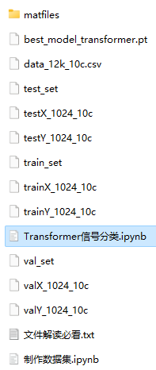

# Pytorch-Transformer bearing fault one-dimensional signal classification

The translation is:

Includes a complete bearing fault dataset, as well as a one-dimensional fault signal dataset, classification data, and label set that have been generated and ready for use. The corresponding code can be run.

Includes data preprocessing code and Transformer classification code.

Environment: Python 3.9

## Images

<!-- PAYMENT_BLOCK -->

## Get this dataset

- Payment link (Stripe): [Buy now](https://buy.stripe.com/3cs8yP7sY87d0vu9AB)
- Payment QR code: 

<!-- /PAYMENT_BLOCK -->
